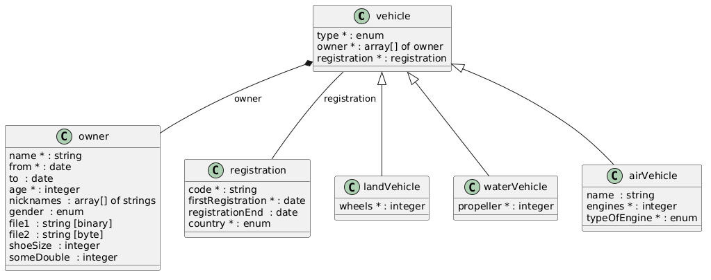
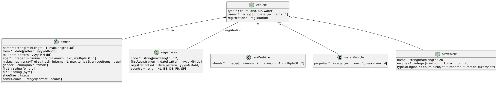

# OpenAPI transformer

[](https://github.com/armand-janssen/openapi-transformer/actions/workflows/node.js.yml)

This tool creates one or more of the following from a **Swagger 2** or **OpenApi 3** specification (a YAML or JSON file, or a URL) -
* Markdown (Optimized for [Showdown](http://showdownjs.com))
* [PlantUML Class Diagram](http://plantuml.com/class-diagram)
* JSON Schema

# Requirements
- Swagger 2 or OpenAPI 3+ Specification
- [NodeJS](http://nodejs.org) 22.13 or newer

# Usage
Run the commands below from the `example` directory of this repository.
```
Usage: cli [options] <inputFileOrUrl>

At least 1 output type must be selected: plantuml, markdown or jsonschema (JSON
Schema)!

Options:
  -V, --version                       output the version number
  -d, --details                       Show extra attribute details
  -p, --plantuml <plantuml file>      Transform to plantuml
  -m, --markdown <markdown file>      Transform to markdown
  -j, --jsonschema <jsonschema file>  Transform to json schema
  -v, --verbose                       Show verbose debug output
  -h, --help                          display help for command
```

Only the schemas under `components.schemas` (OpenAPI 3) or `definitions` (Swagger 2) are rendered, so a spec that only has `paths` produces no output. Referenced files (relative or URL) are followed. Schemas that are neither an object nor an enum are skipped with a `Warning:` line on stderr. Any failure (unreadable file, HTTP error, invalid YAML, no schemas) prints a one-line `Error:` message and exits with code 1; add `--verbose` for the stack trace.

## Example
**Generates to plantuml**
```
openapi-transformer vehicle.yaml --plantuml vehicle.plantuml
```
**Generates to plantuml with verbose debug info :)**
```
openapi-transformer vehicle.yaml --verbose --plantuml vehicle.plantuml
```

**Generates to plantuml file and markdown file**
```
openapi-transformer vehicle.yaml --plantuml ./example.plantuml --markdown ./example.md
```
The generated files for every example spec are committed in `example` and checked by the tests.

# Library
```js
const {
  loadYamlFile, generatePlantUml, generateMarkdown, generateJsonSchema,
} = require('openapi-transformer');

const warnings = []; // optional, receives one message per skipped schema
const schemas = await loadYamlFile('vehicle.yaml', false, warnings);
const uml = generatePlantUml(schemas, false); // second argument: include details
const md = generateMarkdown(schemas);
const json = generateJsonSchema(schemas); // a string
```
The library throws on errors and never prints.

# Example output plantuml

## No details


## Details


# Online utils
- [Online Markdown Editor http://demo.showdownjs.com](http://demo.showdownjs.com)
- [Online PlantUML Editor https://www.planttext.com](https://www.planttext.com)

# Development
```
npm ci
npm run lint
npm test
```
`npm test` runs all tests and requires 95% line and branch coverage. The end-to-end tests compare generated output with the files in `test/expected` and, for the example specs, with the files in `example`. To regenerate them on purpose after an intended output change, run `UPDATE_EXPECTED=1 npm test` and review the diff. The PNG images in `example` are rendered from the `.plantuml` files by hand and are not checked by the tests.

# Changelog

## 0.12.0

### Breaking changes
- Requires Node 22.13 or newer (Node 18 and 20 are end-of-life).
- Failures print a one-line `Error: ...` message naming the file and exit with code 1 (`--verbose` prints the stack trace). This covers unreadable files, invalid YAML/JSON, HTTP errors (non-2xx) and a spec without schemas, which now writes nothing.
- Schemas that are neither an object nor an enum are no longer dropped silently: a `Warning:` line is printed on stderr.
- Enum values are no longer mixed with constraints. PlantUML shows `enum[a, b]` and Markdown lists the values separately from other constraints such as `minItems`; an empty `required` list means no required properties.
- PlantUML no longer draws the `*<|-` "extension" relationship; inheritance is drawn as `Parent <|-- Child`, also for extra allOf parents.
- Referenced `.yml` files are followed; a local reference such as `#/components/schemas/yamlThing` is no longer mistaken for a file.
- Schemas from referenced files are listed in first-seen (depth-first) order, and referenced files are resolved relative to the spec's location (file or URL, including after HTTP redirects).
- Library: `package.json` `main` points at `src/index.js`, so `require('openapi-transformer')` works and exports `loadYamlFile`, `generatePlantUml`, `generateMarkdown` and `generateJsonSchema`; `loadYamlFile(fileOrUrl, verbose, warnings)` takes an optional warnings array and no longer shares state between calls.
- `nyc`, `sinon` and `util` are no longer runtime dependencies (only `commander` and `yaml` remain) and only `src` is published. commander is upgraded 2 to 15.

### Fixes
- Referenced files are awaited, so their schemas are no longer missing from the output.
- In a reference cycle each file is loaded once, also when it is reached by another relative path (`./a.yaml` and `sub/../a.yaml`), so warnings are no longer repeated.
- allOf: all inline members are combined into one schema and parents in other files are loaded.
- Top-level enum schemas are rendered (PlantUML `enum`, Markdown "Values", JSON Schema string enum) instead of being dropped.
- JSON Schema: references to the first (root) schema point at `#`; arrays of primitives, `anyOf`, `oneOf` and `allOf` arrays, arrays without `items`, `binary` and `byte` strings, the `date` pattern and per-schema descriptions are generated correctly.
- Empty input and schemas without `properties` no longer crash.

### Additions
- `-j, --jsonschema` and `-d, --details` are now documented in this README; the help text names all three output types.
- The generated example outputs in `example` are checked by the tests so they cannot drift.
- CI runs lint and tests on Node 22.13, 22.x, 24.x and 26.x.
